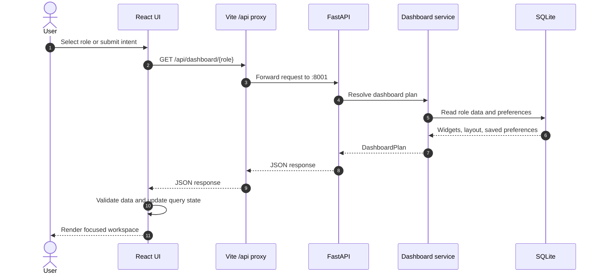

# Intent Workspace

> An adaptive professional workspace that turns role, intent, and context into a focused daily dashboard.

Intent Workspace is a full-stack prototype for role-aware productivity. The React client provides the workspace experience, while the FastAPI service owns dashboard planning, preferences, actions, and persistence.

## What It Does

- Guides a user through role-based onboarding.
- Builds a role-aware dashboard from backend data.
- Lets users compose intent-driven prompts and update their workspace.
- Persists preferences, widget order, visibility, and layout choices in SQLite.
- Separates UI concerns from API, service, and data layers so the prototype can grow cleanly.

## High-Level Design

The system is intentionally small at runtime: one browser client, one API service, and one local database. The Vite development server owns browser assets and forwards `/api` requests to FastAPI.

```mermaid
%%{init: {"theme": "base", "themeVariables": {"primaryColor": "#e8f1ff", "primaryTextColor": "#12233f", "primaryBorderColor": "#3974d8", "lineColor": "#58708f", "secondaryColor": "#eef8f2", "tertiaryColor": "#fff7e8", "fontFamily": "Segoe UI, sans-serif"}}}%%
flowchart LR
	user((User))

	subgraph client[Browser Client]
		ui[React workspace UI]
		state[Providers and query state]
		apiClient[Axios API client]
	end

	subgraph edge[Local Development Edge]
		vite[Vite dev server\nlocalhost:5173]
		proxy[/api proxy/]
	end

	subgraph server[FastAPI Application]
		routes[API routers\nhealth, roles, dashboard, prompt, actions, preferences]
		services[Application services\nDashboard and AI orchestration]
		models[SQLAlchemy models]
	end

	db[(SQLite\nintent_workspace.db)]
	ai[Optional AI provider]

	user --> ui
	ui <--> state
	state <--> apiClient
	apiClient --> vite
	vite --> proxy
	proxy --> routes
	routes --> services
	services --> models
	models <--> db
	services -. optional .-> ai

	classDef browser fill:#e8f1ff,stroke:#3974d8,stroke-width:1.5px
	classDef edge fill:#fff7e8,stroke:#d68b22,stroke-width:1.5px
	classDef server fill:#eef8f2,stroke:#32915a,stroke-width:1.5px
	classDef store fill:#f7efff,stroke:#8b5fc7,stroke-width:1.5px
	class user,ui,state,apiClient browser
	class vite,proxy edge
	class routes,services,models server
	class db,ai store
```



### Request Motion

This sequence shows the normal dashboard path from a user action to a rendered workspace. The arrows represent the runtime movement of data through the system.



## Repository Layout

```text
intent-workspace/
|-- backend/
|   |-- app/
|   |   |-- api/          FastAPI route modules
|   |   |-- db/           Async SQLAlchemy engine and models
|   |   |-- services/     Dashboard and AI orchestration
|   |   |-- main.py       FastAPI application entry point
|   |-- requirements.txt
|-- frontend/
|   |-- src/
|   |   |-- app/          App shell and providers
|   |   |-- components/   Shared UI primitives
|   |   |-- features/     Onboarding and workspace experiences
|   |   |-- lib/          API client, query client, utilities
|   |   |-- styles/       Global Tailwind styles
|   |-- package.json
|   |-- vite.config.ts
|-- README.md
```

## Prerequisites

- Windows PowerShell
- Node.js 18 or newer
- Python 3.10 or newer

## Quick Start on Windows

Run the backend and frontend in two separate PowerShell terminals.

### 1. Backend

```powershell
cd "C:\Users\LENOVO\OneDrive\Desktop\workflow\intent-workspace\backend"
python -m venv .venv
.\.venv\Scripts\python.exe -m pip install -r requirements.txt
.\.venv\Scripts\python.exe -m uvicorn app.main:app --reload --host 127.0.0.1 --port 8001
```

Backend URLs:

- API root: `http://127.0.0.1:8001/`
- Health check: `http://127.0.0.1:8001/api/health`

### 2. Frontend

```powershell
cd "C:\Users\LENOVO\OneDrive\Desktop\workflow\intent-workspace\frontend"
npm install
npm run dev
```

Open `http://localhost:5173/onboarding` in a browser. The Vite proxy sends frontend `/api` calls to the FastAPI service on port `8001`.

## Useful Commands

### Frontend

```powershell
npm run dev          # Start Vite development server
npm run type-check   # Run TypeScript validation
npm run build        # Create a production build
npm run preview      # Preview the production build locally
```

### Backend

```powershell
.\.venv\Scripts\python.exe -m uvicorn app.main:app --reload --port 8001
```

## API Surface

| Area | Endpoints | Responsibility |
| --- | --- | --- |
| Health | `GET /api/health` | Service readiness |
| Roles | `GET /api/roles` | Available professional roles |
| Dashboard | `GET /api/dashboard/{role}` | Role-aware dashboard plan |
| Prompt | `POST /api/prompt` | Intent-based workspace updates |
| Actions | `POST /api/actions/schedule-meeting` | Workspace actions |
| Preferences | `GET/PUT /api/preferences/{role}` | Saved layout and visibility |

## Configuration Notes

- Frontend API calls use the relative `/api` path so development and deployment can share the same client code.
- Vite proxies `/api` to `http://127.0.0.1:8001` during local development.
- SQLite is created locally as `backend/intent_workspace.db` when the API starts.
- AI functionality is optional; the core dashboard can run with the local service and mock data.

## Verification Checklist

```powershell
# Backend responds
Invoke-WebRequest http://127.0.0.1:8001/api/health

# Frontend and proxy respond
Invoke-WebRequest http://localhost:5173/api/health

# Frontend quality checks
cd frontend
npm run type-check
npm run build
```

## Design Direction

Intent Workspace uses a quiet operational interface: dense information where it helps scanning, clear role context, restrained surfaces, and intentional motion during onboarding and workspace transitions. The UI is designed to make the next useful action obvious without turning the product into a marketing landing page.
