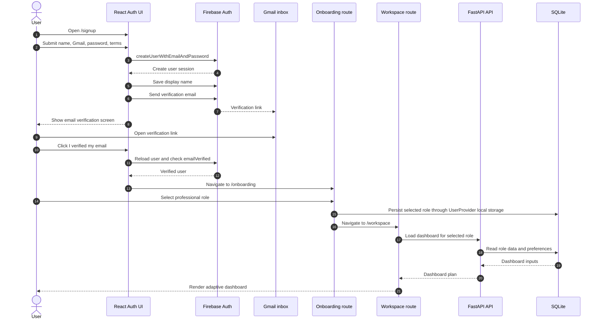
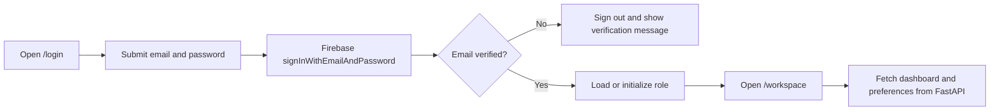

# Intent Workspace

> An adaptive professional workspace that turns role, intent, and context into a focused daily dashboard.

Intent Workspace is a full-stack productivity workspace with Firebase authentication, role-aware onboarding, an adaptive React dashboard, and a FastAPI service for planning, calendar, meetings, Gmail, connections, actions, and preferences.

The diagrams in this document use Mermaid, so they render live on GitHub and in VS Code Markdown preview.

## Current Capabilities

- Firebase email/password signup and login.
- Gmail email verification link after account creation.
- Firebase password-reset emails.
- Role selection before entering the workspace dashboard.
- Profile page from the bottom-left workspace user control.
- Role-aware dashboard plans and widget rendering.
- Intent prompts that update the current workspace plan.
- Calendar events and Google Calendar connection flows.
- Gmail connection, inbox, message actions, sync, and webhook endpoints.
- Meeting processing and summarization endpoints.
- Persisted role preferences, widget visibility, ordering, and saved layouts in SQLite.
- Optional AI orchestration through the backend service layer.

## System Architecture

The runtime has four cooperating boundaries: the browser client, Firebase Authentication, the FastAPI API, and local or external data services.

```mermaid
%%{init: {"theme": "base", "themeVariables": {"primaryColor": "#e8f1ff", "primaryTextColor": "#12233f", "primaryBorderColor": "#3974d8", "lineColor": "#58708f", "secondaryColor": "#eef8f2", "tertiaryColor": "#fff7e8", "fontFamily": "Segoe UI, sans-serif"}}}%%
flowchart LR
    user((User))

    subgraph browser[Browser]
        routes[React Router]
        authUi[Auth screens]
        workspaceUi[Onboarding, workspace, profile]
        providers[User and toast providers]
        query[React Query]
        apiClient[Axios API client]
        firebaseClient[Firebase Auth SDK]
    end

    subgraph identity[Identity]
        firebase[Firebase Authentication]
        gmail[Gmail inbox]
    end

    subgraph edge[Development edge]
        vite[Vite dev server :5173]
        proxy[/api proxy]
    end

    subgraph api[FastAPI :8001]
        routers[API routers]
        services[Application services]
        models[SQLAlchemy models]
    end

    sqlite[(SQLite database)]
    google[Google Calendar and Gmail APIs]
    ai[Optional AI provider]

    user --> routes
    routes --> authUi
    routes --> workspaceUi
    authUi --> firebaseClient
    firebaseClient <--> firebase
    firebase --> gmail
    workspaceUi --> providers
    providers --> query
    query --> apiClient
    apiClient --> vite
    vite --> proxy
    proxy --> routers
    routers --> services
    services --> models
    models <--> sqlite
    services -. OAuth and sync .-> google
    services -. summaries and planning .-> ai

    classDef browserNode fill:#e8f1ff,stroke:#3974d8,stroke-width:1.5px
    classDef identityNode fill:#fff7e8,stroke:#d68b22,stroke-width:1.5px
    classDef apiNode fill:#eef8f2,stroke:#32915a,stroke-width:1.5px
    classDef storeNode fill:#f7efff,stroke:#8b5fc7,stroke-width:1.5px
    class user,routes,authUi,workspaceUi,providers,query,apiClient,firebaseClient browserNode
    class firebase,gmail,vite,proxy identityNode
    class routers,services,models apiNode
    class sqlite,google,ai storeNode
```

### Architectural Responsibilities

| Boundary | Owns | Does not own |
| --- | --- | --- |
| React/Vite frontend | Routes, forms, UI state, role selection, dashboard rendering, API calls | Database queries or provider secrets |
| Firebase Auth | Account creation, sign-in, email verification, password reset, session identity | Workspace roles and dashboard data |
| FastAPI backend | Dashboard planning, prompts, actions, meetings, Gmail, calendar, connections, preferences | Browser layout and Firebase UI |
| SQLite and service providers | Local persistence, Google Calendar/Gmail data, optional AI responses | React navigation |

## End-to-End User Flow

The normal new-user path is account creation, email verification, role selection, and then workspace access.



### Existing User Sign-In



## Frontend Routes

| Route | Screen | Purpose |
| --- | --- | --- |
| `/` | Home | Product entry point and sign-in/sign-up actions |
| `/login` | Auth | Firebase email/password sign-in |
| `/signup` | Auth | Firebase account creation and verification handoff |
| `/onboarding` | Onboarding | Select a role before dashboard access |
| `/workspace` | Workspace | Dashboard, inbox, calendar, meetings, notes, tasks, connections |
| `/profile` | Profile | View prototype user profile, role, and workspace focus |

The workspace bottom-left identity control opens `/profile`; the adjacent logout control clears the local role and returns through the existing auth behavior.

## Backend API Surface

All backend routes are mounted under `/api` unless noted otherwise.

| Area | Endpoints | Responsibility |
| --- | --- | --- |
| Health | `GET /health` | Service readiness |
| Roles | `GET /roles` | Available professional roles |
| Dashboard | `GET /dashboard/{role}` | Role-aware dashboard plan |
| Prompt | `POST /prompt` | Intent-based workspace updates |
| Actions | `POST /actions/schedule-meeting` | Schedule workspace actions |
| Preferences | `GET/PUT /preferences/{role}` | Saved layout and widget preferences |
| Calendar | `GET/POST/PUT/DELETE /calendar/events` | Calendar event management |
| Connections | `GET /connections`, OAuth, toggle, sync | Connected-app lifecycle |
| Gmail | `/gmail/connection`, OAuth, messages, sync, webhook | Gmail inbox and synchronization |
| Meetings | `POST /meetings/process`, `/meetings/summarize` | Meeting intelligence |

## Repository Layout

```text
intent-workspace/
|-- backend/
|   |-- app/
|   |   |-- api/              FastAPI routers
|   |   |-- ai/               AI integration helpers
|   |   |-- data/             Mock and seed data
|   |   |-- db/               Async SQLAlchemy engine and models
|   |   |-- services/         Dashboard, AI, calendar, meeting services
|   |   |-- main.py           FastAPI app and router registration
|   |-- requirements.txt
|-- frontend/
|   |-- src/
|   |   |-- app/              App shell and providers
|   |   |-- components/       Shared UI primitives
|   |   |-- features/
|   |   |   |-- auth/         Login, signup, reset, verification UI
|   |   |   |-- onboarding/   Role selection
|   |   |   |-- profile/      Profile page
|   |   |   |-- workspace/    Dashboard and workspace pages
|   |   |-- lib/
|   |       |-- api.ts        Typed Axios API client
|   |       |-- firebase.ts   Firebase Auth integration
|   |       |-- query-client.ts
|   |-- .env.example         Firebase configuration template
|   |-- .env.local            Local Firebase values; ignored by Git
|   |-- FIREBASE_SETUP.md     Firebase Console setup guide
|   |-- package.json
|   |-- vite.config.ts
|-- README.md
```

## Prerequisites

- Windows PowerShell
- Node.js 18 or newer
- Python 3.10 or newer
- A Firebase project with a registered Web app
- Firebase Authentication with **Email/Password** enabled
- A Google Cloud/Firebase configuration for Gmail or Calendar integrations when those features are used

## Local Setup

Run the backend and frontend in separate PowerShell terminals.

### 1. Backend

```powershell
cd "C:\Users\LENOVO\OneDrive\Desktop\workflow\intent-workspace\backend"
python -m venv .venv
.\.venv\Scripts\python.exe -m pip install -r requirements.txt
.\.venv\Scripts\python.exe -m uvicorn app.main:app --reload --host 127.0.0.1 --port 8001
```

Backend URLs:

- API root: `http://127.0.0.1:8001/`
- Health check: `http://127.0.0.1:8001/api/health`
- OpenAPI docs: `http://127.0.0.1:8001/docs`

### 2. Frontend

```powershell
cd "C:\Users\LENOVO\OneDrive\Desktop\workflow\intent-workspace\frontend"
npm install
Copy-Item .env.example .env.local
npm run dev
```

Open `http://localhost:5173/`. Vite serves the React application and forwards `/api` calls to FastAPI on port `8001`.

### 3. Firebase environment

Open [frontend/FIREBASE_SETUP.md](frontend/FIREBASE_SETUP.md) for the Firebase Console steps. Put the Web app configuration in `frontend/.env.local`:

```dotenv
VITE_FIREBASE_API_KEY=...
VITE_FIREBASE_AUTH_DOMAIN=...
VITE_FIREBASE_PROJECT_ID=...
VITE_FIREBASE_STORAGE_BUCKET=...
VITE_FIREBASE_MESSAGING_SENDER_ID=...
VITE_FIREBASE_APP_ID=...
```

`.env.local` is ignored by Git. Firebase browser configuration values are not server secrets; never place Firebase service-account JSON or private keys in the frontend.

### Gmail verification note

Firebase Authentication sends a secure verification link to the user's Gmail inbox. Firebase does not natively send six-digit Gmail OTP codes. A numeric email OTP would require a trusted backend mail provider, one-time-code storage, expiration, replay protection, and rate limiting.

## Useful Commands

### Frontend

```powershell
npm run dev          # Start Vite on port 5173
npm run type-check   # Run TypeScript validation
npm run build        # Create a production build
npm run preview      # Preview the production build locally
```

### Backend

```powershell
.\.venv\Scripts\python.exe -m uvicorn app.main:app --reload --port 8001
```

## Verification Checklist

```powershell
# Backend health
Invoke-WebRequest http://127.0.0.1:8001/api/health

# Frontend proxy and backend health
Invoke-WebRequest http://localhost:5173/api/health

# Frontend checks
cd frontend
npm run type-check
npm run build
```

Manual product flow:

1. Open `/signup`.
2. Create an account with a real Gmail address.
3. Open the Firebase verification link.
4. Return to the app and click **I verified my email**.
5. Select a role on onboarding.
6. Enter the workspace and open the bottom-left profile control.
7. Sign out and sign in again with the verified account.
8. Test password reset from **Forgot password?**.

## Production Readiness Notes

- Firebase Auth is currently integrated in the browser for signup, sign-in, verification, and password reset.
- The current FastAPI routes do not yet validate Firebase ID tokens. Before exposing private workspace data publicly, add a backend Firebase Admin SDK verification dependency and require a verified bearer token on protected routes.
- Replace SQLite with a managed database for multi-user deployment.
- Configure production CORS origins instead of localhost-only origins.
- Move Google OAuth secrets and provider credentials to backend environment variables or a secret manager.
- Configure Firebase Authorized domains for the deployed frontend hostname.
- Add automated backend tests, frontend route tests, and end-to-end auth tests before production release.

## Design Direction

Intent Workspace uses a quiet operational interface: dense information where it helps scanning, clear role context, restrained surfaces, and intentional motion during onboarding and workspace transitions. The product experience is built around the next useful action rather than a marketing landing page.
